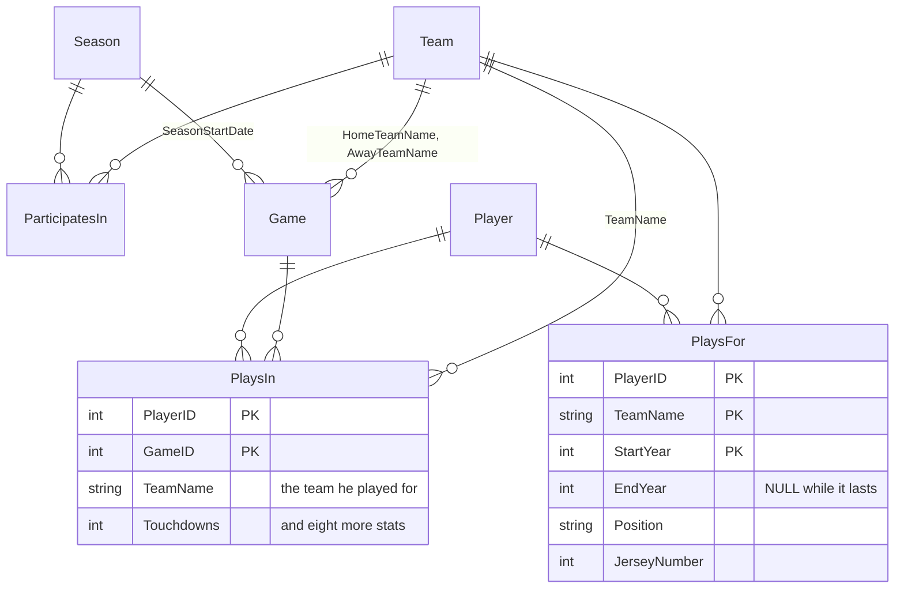

CSC 355 Football Database
=========================

A PHP and MySQL site over a football league's database: teams, players, seasons, games and each
player's stats in each game. It shows the raw tables and runs a set of queries: joins of two and
three tables, a self-join, aggregates with `GROUP BY` and `HAVING`, a `LIKE` search, a subquery, a
stored function and a stored procedure.

A team project for the CSC 355 databases course, Fall 2025, revised in October 2026. The version
as submitted is the tag `first-version`.

Run it
------
```bash
docker compose up --build          # the site, at http://localhost:8080
docker compose run --rm tests      # 20 known-answer tests
```

The database loads from `sql/`: the schema, the routines, and an invented league of 8 teams over 4
seasons, 176 players and 9,856 stat lines, in which a fifth of the players change teams before
each new season (`scripts/make_league.py`; none of the teams or players are real). The tests
compare the pages with answers the generator knows from how it built the league.

On a PHP server with MySQL 8.0.16 or later: run the three files in `sql/` in order, copy
`config.example.php` to `config.php` with the database's settings, and upload the PHP and HTML
files. `config.php` is ignored by git. Without it the settings come from the environment
(`DB_HOST`, `DB_NAME`, `DB_USER`, `DB_PASSWORD`).

The database
------------


`docs/` has the team's ERD, schema diagram and project summary. Two columns were added to them:

- **`PlaysFor.EndYear`**: when a stint ended. A player's history is a list of stints, and
  `StartYear` is part of the key, so a player can return to a team he left.
- **`PlaysIn.TeamName`**: which team the player was playing for in that game.

Rules the database enforces:

- **Counting stats can't be negative,** on INSERT or UPDATE: tackles, interceptions, deflections,
  forced fumbles, fumble recoveries and touchdowns. These are `CHECK` constraints. Yards can be
  negative, because a run stopped behind the line loses yards.
- **A stat line's team must be one of the game's two teams,** and one the player was on that
  season. A `CHECK` can't look at other tables, so two triggers enforce this, on INSERT and
  UPDATE.
- **A team can't play itself,** and scores can't be negative.

Pages
-----
| Link | Pattern | Shows |
|---|---|---|
| `q=table&t=…` | | Any of the seven tables |
| `players_teams` | Two-table join | Every stint, with its years |
| `player_game_stats` | Three-table join | Each player's games, and the team he played for |
| `teammates` | Self-join | Players whose stints with a team overlap by at least a season |
| `td_totals` | Aggregate | Touchdowns per player |
| `interceptions` | `GROUP BY` / `HAVING` | Players with 3 or more interceptions |
| `search` | `LIKE` | Players by part of a last name; `%` and `_` match themselves |
| `season_teams` | Subquery | The teams in the latest season |
| `team_touchdowns` | Aggregate | Touchdowns per team, each counted for the team it was scored for |
| `function` | Stored function | `PlayerFullName` for every player |
| `procedure` | Stored procedure | `GetTeamRoster(team, season)`: one season's roster, the latest if no season is given |

Each query is in `queries.php`. `run_query.php` runs it and draws the table.

What changed from the first version
-----------------------------------
`evaluation/` runs both versions on the same league and scores them against its known answers.
These figures are for the league in `sql/`, where a fifth of the players move each off-season.

- **Team totals counted a player's touchdowns for every team he had played for.** `PlaysIn` was
  joined to `PlaysFor` on `PlayerID` alone, so each stat line was repeated once per team in his
  history. The league scored 840 touchdowns; the page reported 1,266, and every team was
  overstated. A player with 14 touchdowns for one team and 17 for the next was credited with all
  31 at both.
- **Teammates were anyone who had ever played for the same team.** The page listed 4,832 pairs;
  3,836 shared a season. It now compares the years of each stint. It also showed last names only,
  which can't tell apart two players who share one; it now shows full names.
- **A roster was everyone who had ever played for the team.** Between 31 and 40 players a team,
  where each had 22.
- **"Teams in the latest season" stopped with a fatal error.** It used `SeasonStart`, a column the
  schema calls `StartDate`. On a server that displays PHP errors, the page printed part of the SQL
  and the file's path.
- **The trigger guarded only INSERT, and only two stats.** An UPDATE could set touchdowns to −3, and
  an INSERT could record −4 tackles. Both are now refused.
- **Errors showed internals.** A failed connection printed the database user and the web server's
  address to the visitor. Errors now go to the server's log, and the visitor gets a plain message.
- **The `Team` table couldn't be viewed,** and `%` in the search box matched every player.
- **The database password was in `db_connect.php`.** It has been removed from the repository's
  history. Settings now come from `config.php` or the environment.
- **The repository couldn't be run.** It had diagrams, but no schema or data. It now has both,
  plus Docker Compose and the tests.

When nobody changes teams, the first version's answers are all correct. That matches its ERD,
which gives each player exactly one team. Its schema allows many, and over "many seasons", as the
project summary puts it, players do change teams.
